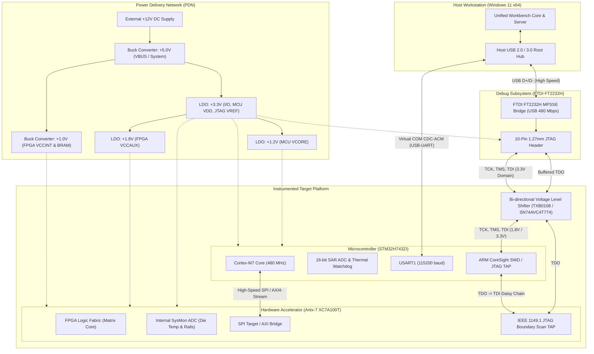

# Embedded System Hardware Integration Architecture (Simulated)

> **Document Status:** Architectural Specification & Interface Definition  
> **Target Environment:** PASS Science Works – Unified Engineering Workbench  
> **Classification:** SIMULATED Hardware Integration

---

## 1. System Overview & Block Diagram

The workbench architecture integrates host-side simulation and real-world hardware-in-the-loop (HIL) instrumentation. The embedded ecosystem encompasses three distinct sub-systems:
1. **Host Workstation:** Running the C++ Core Engine, HTTP REST Service, and Web Presentation Layer.
2. **JTAG Debug Adapter (FTDI FT2232H):** Dedicated USB-to-JTAG/SWD bridge operating in Multi-Protocol Synchronous Serial Engine (MPSSE) mode.
3. **Application Microcontroller (STM32H743ZI):** ARM Cortex-M7 managing high-speed analog acquisition (ADC), safety interlocks, and local telemetry.
4. **Hardware Accelerator (Xilinx Artix-7 XC7A100T):** FPGA running custom RTL for accelerated sparse matrix assembly and parallel thermal evaluation.

### 1.1 Mermaid Hardware Block Diagram

---

## 2. Interface, Pinout & Voltage Domain Specifications

### 2.1 Voltage Domains & Level Shifting Requirements
Mixed-signal embedded systems operate across multiple distinct supply voltages. Driving a pin above its $V_{\text{CCO}}$ rail triggers parasitic ESD diodes, risking latch-up, thermal runaway, or permanent gate dielectric breakdown.

| Voltage Domain | Nominal Rail | Tolerance | Components Powered | Level Shifting Requirement |
|---|---|---|---|---|
| **$V_{\text{BUS}} / V_{\text{SYS}}$** | $+5.0\text{ V}$ | $\pm 5\%$ | Input buck converters, USB transceivers | Isolation from all $3.3\text{ V} / 1.8\text{ V}$ logic |
| **$V_{\text{DD\_IO}}$** | $+3.3\text{ V}$ | $\pm 3\%$ | STM32 GPIOs, FTDI FT2232H I/O, JTAG Header, Flash SPI | Reference domain for Host JTAG $V_{\text{REF}}$ |
| **$V_{\text{CORE\_MCU}}$** | $+1.2\text{ V}$ | $\pm 2\%$ | STM32 internal Cortex-M7 core logic | Internal LDO / SMPS; no external I/O |
| **$V_{\text{CCAUX\_FPGA}}$** | $+1.8\text{ V}$ | $\pm 2\%$ | Artix-7 auxiliary circuits, JTAG TAP bank (Bank 0) | Level shifted between 3.3V FTDI and 1.8V FPGA |
| **$V_{\text{CCINT\_FPGA}}$** | $+1.0\text{ V}$ | $\pm 2\%$ | Artix-7 internal configurable logic blocks (CLB) | Internal power rail; strictly regulated |

### 2.2 Pinout & Signal Mapping Table

| Connector | Pin # | Signal Name | Direction (re: Target) | Voltage Domain | Description & Termination |
|---|---|---|---|---|---|
| **JTAG Header (10-pin)** | 1 | `VREF / VTARG` | Output to Debugger | $3.3\text{ V}$ | Senses target board power status (100 mA fused) |
| | 2 | `TMS / SWDIO` | Input from FTDI | $3.3\text{ V} \to 1.8\text{ V}$ | TAP Mode Select / Bi-dir SWD data (10k pull-up to $V_{\text{REF}}$) |
| | 3 | `GND` | Ground | $0.0\text{ V}$ | Digital ground return |
| | 4 | `TCK / SWCLK` | Input from FTDI | $3.3\text{ V} \to 1.8\text{ V}$ | Test Clock up to 30 MHz (10k pull-down) |
| | 5 | `GND` | Ground | $0.0\text{ V}$ | Digital ground return |
| | 6 | `TDO / SWO` | Output to FTDI | $1.8\text{ V} \to 3.3\text{ V}$ | Serial Test Data Out (buffered via SN74LVC1T45) |
| | 7 | `KEY` | N/A | N/A | Key pin (pin removed to prevent inversion) |
| | 8 | `TDI` | Input from FTDI | $3.3\text{ V} \to 1.8\text{ V}$ | Serial Test Data In (10k pull-up to $V_{\text{REF}}$) |
| | 9 | `GND` | Ground | $0.0\text{ V}$ | Digital ground return |
| | 10 | `nRESET` | Open-Drain / In | $3.3\text{ V}$ | Target hardware reset line (active low, 10k pull-up) |
| **MCU COM Header** | 1 | `MCU_TXD` | Output to Host | $3.3\text{ V}$ | USART1 asynchronous serial transmit (115200 baud) |
| | 2 | `MCU_RXD` | Input from Host | $3.3\text{ V}$ | USART1 asynchronous serial receive |
| | 3 | `GND` | Ground | $0.0\text{ V}$ | Signal ground reference |
| **FPGA High-Speed SPI** | 1 | `SPI_SCK` | Input from MCU | $3.3\text{ V}$ | SPI Serial Clock (up to 50 MHz) |
| | 2 | `SPI_MOSI` | Input from MCU | $3.3\text{ V}$ | Master-Out Slave-In data line |
| | 3 | `SPI_MISO` | Output to MCU | $3.3\text{ V}$ | Master-In Slave-Out data line |
| | 4 | `SPI_CS_N` | Input from MCU | $3.3\text{ V}$ | Active-low chip select |

### 2.3 JTAG Signal Ownership & Bus Arbitration
- **Master Ownership:** The Host PC via FTDI FT2232H is the **sole bus master** for `TCK`, `TMS`, and `TDI`. Under no circumstances may any slave drive `TCK` or `TMS`.
- **Slave Ownership:** `TDO` is driven by the currently addressed TAP controller during `Shift-IR` and `Shift-DR` states. When the TAP controller is in any other state (`Test-Logic-Reset`, `Run-Test/Idle`, `Update-DR`), `TDO` drivers enter high-impedance ($Z$).
- **Daisy-Chain Order:** `FTDI TDI` $\to$ `MCU CoreSight TAP` $\to$ `FPGA Artix-7 TAP` $\to$ `FTDI TDO`.

---

## 3. Why JTAG is a Debug Interface (Not a Compute Board)

A common misconception in embedded acceleration is treating a JTAG adapter as a general-purpose compute accelerator or high-speed streaming data bridge. The fundamental architectural limitations are:

1. **Serial Shift-Register Latency ($O(B \times L)$):**  
   JTAG operates on single-bit shift chains. Reading a 32-bit register from a target requires shifting 32 clock cycles of data through the entire daisy chain, plus TAP state transition preamble (`Select-DR-Scan` $\to$ `Capture-DR` $\to$ `Shift-DR`).
2. **Lack of Hardware Flow Control & Framing:**  
   Standard IEEE 1149.1 does not provide retransmission, packet headers, cyclic redundancy check (CRC) verification, or backpressure flow control (unlike USB, PCIe, or Ethernet). If the host shifts data faster than a target co-processor can consume it, data is lost silently without bus arbitration.
3. **Throughput Bottleneck:**  
   Even high-speed MPSSE JTAG clocked at $30\text{ MHz}$ achieves a theoretical raw bit-stream limit of $\approx 3.75\text{ MB/s}$. In contrast, USB-CDC/UART achieves deterministic packetized telemetry, while PCIe Gen2 x1 on Artix-7 delivers $\approx 500\text{ MB/s}$ and quad-SPI achieves $> 50\text{ MB/s}$.
4. **Primary Architectural Purpose:**  
   JTAG is designed for **Boundary Scan testing (fault isolation on PCB traces), non-volatile flash configuration, register inspection, and CPU execution halt/resume**. Real-time engineering telemetry and compute acceleration belong on memory-mapped PCIe, AXI DMA, or USB-CDC buses.

---

## 4. Safe Integration & Commissioning Plan

To transition from the simulated C++ workbench mock adapters to physical embedded hardware without hardware damage:

### Phase 1: Cold Resistance & Continuity Verification (Unpowered)
1. Verify $0.0\,\Omega$ continuity across all ground return paths between Host, JTAG adapter, MCU board, and FPGA board.
2. Measure resistance from $+3.3\text{ V}$, $+1.8\text{ V}$, $+1.2\text{ V}$, and $+1.0\text{ V}$ to `GND`. Any impedance $< 50\,\Omega$ indicates solder bridging or silicon short.

### Phase 2: Power Sequencing & Voltage Verification
1. Power up the system in strict monotonic sequence:
   $$\text{System } 5\text{V} \implies 3.3\text{V (I/O)} \implies 1.8\text{V (VCCAUX)} \implies 1.0\text{V / } 1.2\text{V (Cores)}$$
2. Verify all LDO and DC-DC converter output rails using an oscilloscope before asserting target reset release.

### Phase 3: JTAG Chain Autodiscovery & Sanity Check
1. Connect FTDI FT2232H USB.
2. Sense target $V_{\text{REF}} = 3.30\text{ V} \pm 0.1\text{ V}$.
3. Shift 64 clock cycles of ones to reset the TAP state machine into `Test-Logic-Reset`.
4. Shift `IDCODE` instruction (`0x0E` or `0x09` depending on chain). Verify expected silicon signatures:
   - STM32 CoreSight SW-DP: `0x0BA00477` (ARM)
   - Xilinx Artix-7 100T: `0x0362D093` (Xilinx)

### Phase 4: Firmware Heartbeat & Watchdog Commissioning
1. Flash minimal test firmware configuring UART1 at 115200 baud with a 10 Hz telemetry packet.
2. Enable hardware Independent Watchdog (IWDG) on the MCU with a 2000 ms timeout window.
3. Validate simulated-to-real adapter transition using the Workbench Hardware Tab.

---

## 5. Known Limitations of the Current Prototype
- Hardware communication is currently mediated by high-fidelity C++ mock adapters (`workbench::EmbeddedManager`).
- JTAG boundary-scan registers and TAP controller state transitions are accurately modeled in C++, but do not drive physical GPIO pins without libftdi/OpenOCD installed.
- Telemetry streams simulate realistic thermal fluctuations, clock frequencies, and timeout-retry sequences. Physical serial port bindings (Win32 COM / POSIX termios) are isolated behind the adapter interface.
